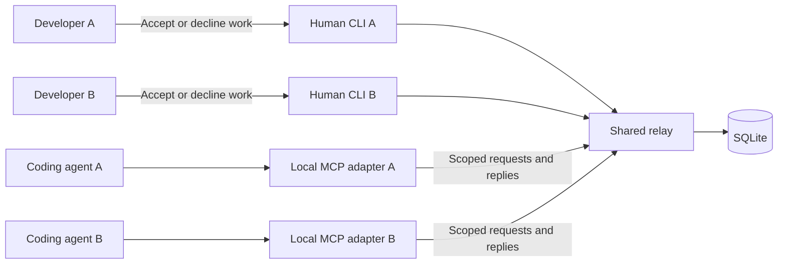

# Agent Bridge

**A shared inbox for two developers' coding agents.**

Request work from a teammate's agent, record the decisions you agree on, and hand back a specific result while each developer stays in control of their own machine.

**Status: documentation foundation.** The relay, MCP adapter, and approval interface are planned, not implemented. There is no runnable coordination service, published package, or verified assistant integration yet. The working name is Agent Bridge.

[Scope](docs/SCOPE.md) · [Architecture](docs/ARCHITECTURE.md) · [Decisions](docs/DECISIONS.md) · [Roadmap](docs/ROADMAP.md) · [Contributing](CONTRIBUTING.md)

## Why build this?

Two developers can work on the same service with separate coding assistants and still spend much of their time copying explanations between them:

- One agent needs an interface owned by the other developer.
- An agreed response shape changes, but the other agent keeps using the old assumption.
- An agent finishes its work, but its teammate needs the relevant decision, commit, and test information to continue.

This project grew out of that coordination problem in a university banking CRM project. We want to test whether a small shared inbox reduces manual relaying without adding another layer of busywork.

The first proof of concept is for two people using one repository on separate machines. It is an experiment in useful coordination, not a claim that agent collaboration is a new category or that market fit has been established.

## The intended experience

The following is a proposed workflow, not a live demo:

1. You and your teammate join the same workspace and declare the areas you own.
2. Your agent requests a change or clarification from the other participant, attaching selected file and commit references.
3. Your teammate reads the request and explicitly accepts work through the human interface.
4. Their agent retrieves the accepted request, replies with questions or a proposed decision, and works within its existing local permissions.
5. Agreed decisions are recorded with a revision. A changed proposal needs fresh agreement from both participants.
6. The agent reports completion with a summary, branch, commit, and reported check results.
7. You fetch, review, test, and merge using your normal Git workflow.

An inbox check is required to receive updates. The first version will not wake stopped agents or interrupt active sessions automatically. A requester's message cannot authorize work on another developer's machine.

## How the pieces fit together



The relay is a mailbox and record keeper. It does not run a model, edit repositories, execute shell commands, or merge code. Reasoning and code changes stay with the developers' existing assistants.

The coordinator is planned in TypeScript with SQLite storage. It will not require its own model API key; assistant access and eventual hosting are separate requirements.

## What this adds to Git workflows

Stacked PRs organize dependent code changes. Agent Bridge explores the earlier conversation: asking for missing work, answering questions, agreeing on an interface, and returning enough context for the other person to continue. It is intended to coexist with Git, code review, and CI.

Existing projects already overlap with this idea. [CodeRelay](https://github.com/AymanAhsan/CodeRelay) documents cross-developer handoffs and commit-pinned contracts; [Aethereum](https://www.aethereum.dev/) and [Cork](https://corkcli.com/) describe cross-agent coordination. We will compare useful workflows rather than claim uniqueness from messaging or MCP support alone.

## Get started today

At this stage you can inspect the design, contribute, and run the repository checks. You cannot start a relay yet.

Prerequisites: Git and Node.js 24.x.

Clone the repository and check the documentation foundation:

```sh
git clone https://github.com/GarvitSobti/agentbridge.git
cd agentbridge
node scripts/check-repo.mjs
```

Or use the equivalent npm script:

```sh
npm run check
```

There are no package dependencies to install. On Windows PowerShell, use `npm.cmd run check` if execution policy blocks `npm.ps1`.

These checks validate the documentation foundation, local file links, and configuration. They are not runtime or agent-integration tests. Setup commands for the relay and MCP adapter will be added when those components exist and have been exercised.

## First proof of concept

| Included | Outside the first version |
| --- | --- |
| Two developers, one repository, separate branches | Multi-team orchestration or repository fleets |
| Explicit recipients and declared ownership | Automatic dependency discovery or conflict prediction |
| Requests, replies, and revisioned decisions | Unbounded autonomous agent conversations |
| Human acceptance before requested work starts | Automatic approval, remote shell access, or agent launching |
| Persistent inbox and completion references | Automatic merging, rebasing, or stacked-PR management |
| Explicit inbox checks | Guaranteed background delivery into every assistant |

Ownership declarations help route work; they do not sandbox a coding assistant's filesystem access. Completion reports are claims with references, not independent proof that code is correct.

## How we will judge it

Two developers will try dependent work, a mid-task interface change, and an offline handoff. We will compare with their normal workflow and record manual relays, repeated explanations, rework, completion time, and unnecessary interruptions.

No pilot results are available yet. See the [validation plan](docs/VALIDATION.md) for the scenarios, baseline, and evidence we will collect.

## Project map

| File | Purpose |
| --- | --- |
| [AGENTS.md](AGENTS.md) | Entry point for repository instructions |
| [codex.md](codex.md) | Coding workflow, verification, and handoff conventions |
| [AI_MEMORY.md](AI_MEMORY.md) | Current progress, open questions, and the next concrete task |
| [Scope](docs/SCOPE.md) | Product boundaries and acceptance criteria |
| [Architecture](docs/ARCHITECTURE.md) | Components, data flow, and trust boundaries |
| [Decisions](docs/DECISIONS.md) | Architecture decisions and their rationale |
| [Roadmap](docs/ROADMAP.md) | Small implementation milestones and exit criteria |
| [Security](SECURITY.md) | Data handling expectations and reporting guidance |

## Contribute

Start with [CONTRIBUTING.md](CONTRIBUTING.md). Small changes tied to the first two-person workflow are welcome. Describe which problem a change solves and how it was checked; keep planned behavior separate from implemented behavior.

Created by [Garvit Sobti](https://github.com/GarvitSobti). Released under the [MIT License](LICENSE).
