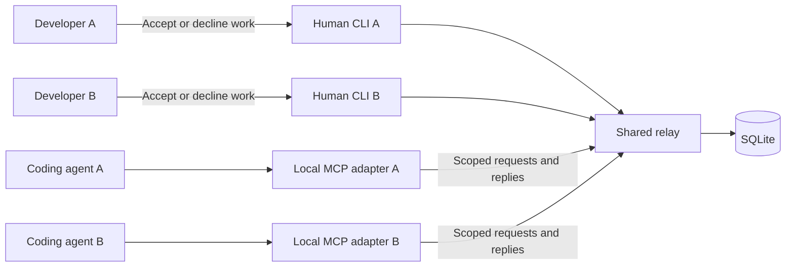

# Agent Bridge

**A shared inbox for two developers' coding agents.**

Request work from a teammate's agent, record the decisions you agree on, and hand back a specific result while each developer stays in control of their own machine.

Try the [optional local review watcher](docs/AUTO_REVIEW.md) to turn one completed handoff into a Codex review of the reported commit.

The [invite-only beta guide](docs/BETA_ONBOARDING.md) walks through browser workspace creation, teammate invites, and agent pairing. See [automatic pickup](docs/AUTOMATIC_PICKUP.md) for the exact prompt approval and local Claude Code runner. The [HTTPS pilot guide](docs/HTTPS_PILOT.md) covers operator provisioning, and the [browser inbox guide](docs/BROWSER_INBOX.md) covers phone approval.

**Status: two-person proof of concept.** Claude Code completed a local handoff that Codex reviewed automatically. A public HTTPS smoke test passed from one laptop with separate Alice and Bob profiles. Hosted workspaces have an invite-only browser inbox with a human approval timeline. A live two-laptop assistant handoff is pending.

[Scope](docs/SCOPE.md) · [Architecture](docs/ARCHITECTURE.md) · [Decisions](docs/DECISIONS.md) · [Roadmap](docs/ROADMAP.md) · [Contributing](CONTRIBUTING.md)

## Why build this?

Two developers can work on the same service with separate coding assistants and still spend much of their time copying explanations between them:

- One agent needs an interface owned by the other developer.
- An agreed response shape changes, but the other agent keeps using the old assumption.
- An agent finishes its work, but its teammate needs the relevant decision, commit, and test information to continue.

This project grew out of that coordination problem in a university banking CRM project. We want to test whether a small shared inbox reduces manual relaying without adding another layer of busywork.

The first proof of concept is for two people using one repository on separate machines. It is an experiment in useful coordination, not a claim that agent collaboration is a new category or that market fit has been established.

## The intended experience

The following is a proposed workflow, not a live demo:

1. You and your teammate join the same workspace and declare the areas you own.
2. Your agent requests a change or clarification from the other participant, attaching selected file and commit references.
3. Your teammate reads the request and explicitly accepts work through the human interface.
4. Their agent retrieves the accepted request, replies with questions or a proposed decision, and works within its existing local permissions.
5. Agreed decisions are recorded with a revision. A changed proposal needs fresh agreement from both participants.
6. The agent reports completion with a summary, branch, commit, and reported check results.
7. You fetch, review, test, and merge using your normal Git workflow.

An inbox check is required to receive updates. The first version will not wake stopped agents or interrupt active sessions automatically. A requester's message cannot authorize work on another developer's machine.

## How the pieces fit together



The relay is a mailbox and record keeper. It does not run a model, edit repositories, execute shell commands, or merge code. Reasoning and code changes stay with the developers' existing assistants.

The coordinator uses TypeScript and SQLite storage. It requires no model API key; local bearer credentials are generated during setup. Assistant access and eventual hosting are separate requirements.

## What this adds to Git workflows

Stacked PRs organize dependent code changes. Agent Bridge explores the earlier conversation: asking for missing work, answering questions, agreeing on an interface, and returning enough context for the other person to continue. It is intended to coexist with Git, code review, and CI.

Existing projects already overlap with this idea. [CodeRelay](https://github.com/AymanAhsan/CodeRelay) documents cross-developer handoffs and commit-pinned contracts; [Aethereum](https://www.aethereum.dev/) and [Cork](https://corkcli.com/) describe cross-agent coordination. We will compare useful workflows rather than claim uniqueness from messaging or MCP support alone.

## Get started today

You can exchange requests through terminal clients or connect a local MCP host using an agent profile. Alice and Bob are local demo identities. The protocol is tested with official SDK clients; actual assistant pairing is the next integration check.

Prerequisites: Git and Node.js 24.x.

Clone the repository, install the pinned dependencies, and run the checks:

```sh
git clone https://github.com/GarvitSobti/agentbridge.git
cd agentbridge
npm ci
npm run check
```

Start the local workspace and relay in one terminal:

```sh
npm run relay:init
npm run relay
```

In another terminal, create a request:

```sh
npm run bridge -- --profile alice-agent request --to bob --title "Expose severity" --body "Please add a severity field."
```

In a third terminal, inspect Bob's inbox:

```sh
npm run bridge -- --profile bob-agent inbox
```

Follow the [local relay guide](docs/LOCAL_RELAY.md) for the complete PowerShell flow: reply, approve with Bob's human profile, start with Bob's agent profile, and verify restart/catch-up. The relay listens on `127.0.0.1:8787`; credentials and its database are stored outside the checkout under `~/.agentbridge/local-demo`.

Run the single-process demonstration:

```sh
npm run demo:domain
npm run demo:storage
npm run demo:pilot
```

The domain demo prints a request, clarification, decision agreement, human-role acceptance, agent-role start, and completion report. The storage demo saves and accepts a synthetic request, closes and reopens its database connection, and verifies safe retry and inbox catch-up. Both demos simulate participants and use a fixture commit ID. The storage demo keeps data under the Git-ignored `.agent-bridge/` directory.

The pilot rehearsal creates two temporary Git checkouts and a relay, revises a contract, records a scripted human approval, and reports the exact commit after running the fixture tests. It then fetches that commit and uses a deterministic reviewer to check what the real review watcher receives. See [the pilot task list](docs/PILOT_TASKS.md) for the command and expected output.

The MCP adapter uses the official `@modelcontextprotocol/server` SDK and Zod; protocol tests use the matching client SDK. TypeScript and Node type definitions provide strict source checking. SQLite, TypeScript execution, and the test runner use Node's built-ins; early Node 24 releases print experimental warnings. On Windows PowerShell, use `npm.cmd` if execution policy blocks `npm.ps1`.

`npm run check` runs documentation checks, strict TypeScript checking, and domain/storage/HTTP/CLI/MCP tests. Tests include independent SQLite writers, a killed writer process, actual loopback connections, and separate stdio adapter processes driven by official SDK clients. These are not real-assistant integration tests. For a dependency-free documentation-only check, use `node scripts/check-repo.mjs`.

To connect a local assistant host, follow the [MCP setup guide](docs/MCP.md). Launch the adapter with Node directly and select an agent profile explicitly. Human acceptance stays in the terminal. This setup currently uses one machine; two-laptop access needs later TLS and provisioning work.

See the [domain API guide](docs/DOMAIN.md) for commands and role rules, and the [storage guide](docs/STORAGE.md) for transactions, migrations, and recovery behavior.

## First proof of concept

| Included | Outside the first version |
| --- | --- |
| Two developers, one repository, separate branches | Multi-team orchestration or repository fleets |
| Explicit recipients and declared ownership | Automatic dependency discovery or conflict prediction |
| Requests, replies, and revisioned decisions | Unbounded autonomous agent conversations |
| Human acceptance before requested work starts | Automatic approval, remote shell access, or agent launching |
| Persistent inbox and completion references | Automatic merging, rebasing, or stacked-PR management |
| Explicit inbox checks | Guaranteed background delivery into every assistant |

Ownership declarations help route work; they do not sandbox a coding assistant's filesystem access. Completion reports are claims with references, not independent proof that code is correct.

## How we will judge it

Two developers will try dependent work, a mid-task interface change, and an offline handoff. We will compare with their normal workflow and record manual relays, repeated explanations, rework, completion time, and unnecessary interruptions.

The public HTTPS smoke test passed all 13 calls. The measured two-person pilot is pending. See the [validation plan](docs/VALIDATION.md) for the scenarios, baseline, and evidence we will collect.

## Project map

| File | Purpose |
| --- | --- |
| [AGENTS.md](AGENTS.md) | Entry point for repository instructions |
| [codex.md](codex.md) | Coding workflow, verification, and handoff conventions |
| [AI_MEMORY.md](AI_MEMORY.md) | Current progress, open questions, and the next concrete task |
| [Scope](docs/SCOPE.md) | Product boundaries and acceptance criteria |
| [Architecture](docs/ARCHITECTURE.md) | Components, data flow, and trust boundaries |
| [Domain API](docs/DOMAIN.md) | Implemented lifecycle rules, inputs, and limitations |
| [Storage](docs/STORAGE.md) | SQLite setup, transactions, migrations, and failure behavior |
| [Local relay](docs/LOCAL_RELAY.md) | Setup, terminal workflow, credentials, and HTTP contract |
| [MCP adapter](docs/MCP.md) | Stdio setup, agent tools, retry rules, and protocol verification |
| [Decisions](docs/DECISIONS.md) | Architecture decisions and their rationale |
| [Roadmap](docs/ROADMAP.md) | Small implementation milestones and exit criteria |
| [Security](SECURITY.md) | Data handling expectations and reporting guidance |

## Contribute

Start with [CONTRIBUTING.md](CONTRIBUTING.md). Small changes tied to the first two-person workflow are welcome. Describe which problem a change solves and how it was checked; keep planned behavior separate from implemented behavior.

Created by [Garvit Sobti](https://github.com/GarvitSobti). Released under the [MIT License](LICENSE).
