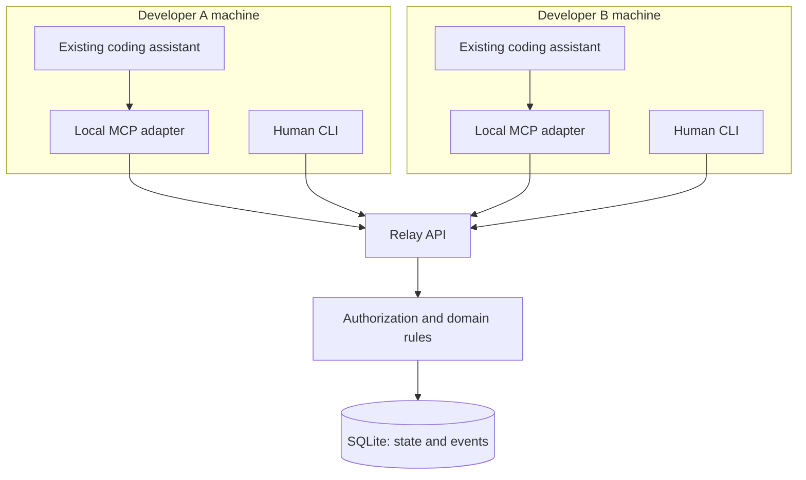

# Architecture

Status: the local lab has exercised two Codex sessions and a Claude Code to Codex handoff. HTTPS transport passed isolated-process tests. A live two-laptop deployment remains open. See [the decisions](DECISIONS.md), [domain guide](DOMAIN.md), [storage guide](STORAGE.md), [local run guide](LOCAL_RELAY.md), and [MCP guide](MCP.md).

## System shape

The local demo has one loopback relay, one database, terminal clients, and stdio MCP adapters for two participants on one machine. The diagram below shows the pilot machine split. In hosted mode an HTTPS proxy on the relay host connects clients to the same API and domain rules.



## Responsibilities

| Component | Responsibility | Boundary |
| --- | --- | --- |
| Domain layer | Validate identities, transitions, decision revisions, and retry keys | No HTTP, model calls, or shell execution |
| Relay API | Authenticate requests, validate payloads, invoke domain operations, return errors | No assistant launching or repository edits |
| SQLite store | Persist current state, messages, agreement revisions, and lifecycle events | One relay instance; local database, not a shared network filesystem |
| MCP adapter | Expose allowed inbox, request, reply, agreement, and completion actions | Agent credential cannot accept work or obtain human credentials |
| Human CLI | Inspect and accept or decline incoming requests | Distinct human credential, kept out of the assistant's configuration |
| Browser inbox | Display requests and recent history, accept or decline as the addressed person | Invite-only session on the registered HTTPS origin. Approvals use the shared domain version and role checks. |
| Review watcher | Wait for one selected completion and prepare a local Git diff for a Codex review | Requester opts in on their machine. The relay stays outside the launch and review flow. |

Implementation language: TypeScript. Runtime: Node.js 24.x. The domain has no platform imports; trusted adapters supply IDs, time, and SHA-256 hashing. The store uses Node's built-in SQLite, and the runtime helper supplies Node crypto and time defaults. Node type definitions are development tooling. Actual compatibility with the two participants' assistant clients and operating systems must still be verified.

## Request lifecycle

```text
pending --addressed human accepts--> accepted --assigned agent starts--> in_progress
   |                                    |                                  |
   +--addressed human declines--> declined                                  +--> completed
   |
   +--requesting human cancels--> cancelled

accepted or in_progress --either participating human cancels--> cancelled
```

Terminal states are completed, declined, and cancelled. Further work uses a new request referencing the old one. Active requests allow messages without implicitly changing their lifecycle state; terminal requests are read-only. Exact retries of earlier successful commands still return their original result without modifying current state.

Decisions are a separate revisioned record. Each participant's human or scoped agent may acknowledge an exact decision revision; this never substitutes for human task acceptance. Starting work requires all decision references attached to the request to have both participants' agreement on their current revision. A new revision clears current agreement and blocks further progress/completion transitions until re-agreed. It cannot automatically stop code already running locally; the agent learns of the change on its next inbox check.

Completion requires an assigned participant, a summary, repository-relative references, a branch, a full commit ID, and reported checks (including an explicit not-run outcome). A completion is self-reported. The relay does not fetch Git objects or independently run the tests in the first version.

## Minimal records

- Workspace: ID, canonical repository identity, creation time.
- Participant: ID, workspace ID, display name, declared ownership paths.
- Credential: hashed token, participant, workspace, human or agent role, revocation state.
- Request: ID, requester, recipient, description, state, selected refs, decision refs, version, retry key.
- Message: ID, request, author and role, bounded body, monotonically increasing event cursor, server time.
- Decision revision: decision ID, revision, selected interface text/refs, content hash, acknowledgments.
- Completion report: request, reporter, branch, commit, summary, check claims and references.
- Event: actor, request/decision ID, operation, before/after version, cursor, server time.

Use database transactions for each state change and event append. Do not implement full event sourcing: current state is stored directly and events provide an audit history. Retry keys are scoped to actor and operation; reusing a key with a different payload is an error. Version checks reject conflicting updates.

## Delivery and reconnects

The MCP events tool accepts an explicit `after` cursor and bounded page limit. The caller saves its cursor; the adapter does not poll, persist a cursor, or launch background work. Reading a message does not accept a task. Offline messages remain stored.

The [local review watcher](AUTO_REVIEW.md) polls one selected request independently of MCP. The terminal request is the source of truth after reconnect. The watcher verifies requester ownership and reads a bounded diff for the exact reported commit from the selected checkout. An exclusive record in the private local directory reserves the attempt before the Codex subprocess starts. An interrupted attempt stays visible as uncertain. The review result remains local and separate from the terminal relay record.

## Trust and credentials

In the hosted pilot, the relay remains on loopback behind a same-host TLS proxy. Each participant receives their own workspace-bound agent and human profiles. The CLI, MCP adapter and review watcher use the HTTPS origin declared in both profile and configuration. See [the HTTPS pilot](HTTPS_PILOT.md). The [browser inbox](BROWSER_INBOX.md) exchanges one-use invitations for HTTPS sessions. The invite-only beta starts with a named HTTPS origin and one owner grant. The owner creates one workspace through the browser, then issues a teammate invite. Both members can exchange short-lived pairing codes for independently generated agent credentials. See [beta onboarding](BETA_ONBOARDING.md) and ADR-016.

The relay operator and database are trusted with deliberately shared messages; end-to-end encryption is outside this first design. TLS is required for access beyond loopback. Never expose an unauthenticated development server to the internet.

Separate human and agent credentials are a server-side capability boundary, not protection from a fully privileged process on the relay host. The human credential must not be passed to an MCP adapter, tool arguments, prompts, or logs. ADR-011 implements local provisioning, private profile storage, and revocation. ADR-014 covers TLS and operator provisioning. ADR-015 covers browser invites and approval.

Peer messages may contain misleading instructions. Display sender identity, role, and references; treat the content as untrusted input. The relay must never interpret message text as an executable command. Declared ownership is coordination metadata, not a filesystem sandbox.

## Source layout

Current source:

```text
src/domain/       Implemented: shared state machine, role rules, and input validation
src/storage/      Implemented: SQLite transactions, migrations, and persistent state
src/runtime.ts    Implemented: server-owned IDs, time, and SHA-256 defaults
src/relay/        Implemented: authenticated loopback HTTP entry point
src/cli/          Implemented: local bootstrap, operator actions, and terminal client
tests/            Implemented: domain, SQLite, HTTP, CLI, and official SDK stdio tests
examples/         Implemented: synthetic domain and storage restart demos
src/mcp/          Implemented: agent-only tools, HTTP client, and stdio entry point
```

Keep one package until separate publishing or deployment needs justify splitting it. Real mixed-client compatibility was tested locally. The official MCP v2 server SDK and Zod are runtime dependencies; the matching client SDK is test tooling (ADR-012).

The MCP process loads a selected agent profile using `src/cli/profiles.ts`, verifies effective identity through HTTP, and connects the SDK stdio transport. It never imports the local SQLite/operator module. Tool schemas allow only agent task operations, require stable retry keys and current versions, and wrap peer text as untrusted data. The HTTP client rechecks identity for each tool, disallows redirects/remote URLs, and limits requests and responses. Protocol validation and dispatch belong to the SDK; authorization and state changes remain in the relay/domain.

The pure executor returns a complete next-state candidate and never writes it. The SQLite adapter reconstructs that reference state inside a transaction and persists the changed request, one event, one retry receipt, and workspace revision together. `BEGIN IMMEDIATE` serializes writers before they read state; request/workspace revision checks provide additional conflict detection. Read methods use a consistent read transaction.

Requests contain revisioned decisions, messages, and completion reports as JSON. Events and retry receipts have separate tables and uniqueness constraints; workspace configuration and schema metadata are stored explicitly. Versioned migrations are transactional. Local file-backed connections use WAL mode with synchronous FULL. The synchronous adapter and unbounded reference histories are suitable for the small proof of concept, not a claim of high-volume performance. There is no network filesystem or multi-host database support.

The domain/store APIs still take trusted in-process Principal objects. The HTTP adapter establishes those identities by hashing the bearer token and querying the scoped, non-revoked credential registry. It rechecks after reading a command body. Client-supplied role fields and profile metadata cannot change the server-derived role.

Credential profiles are initialized outside the checkout under ~/.agentbridge/local-demo by default. Human and agent files are separate, and the SQLite table stores token hashes and metadata. The operator's filesystem remains trusted. Clients accept loopback HTTP for local profiles and the registered HTTPS origin for hosted profiles. The terminal and MCP API rejects browser Origin headers. The browser routes reject writes unless Origin matches the registered HTTPS origin. All routes enforce the loopback upstream Host and apply input and resource limits.
