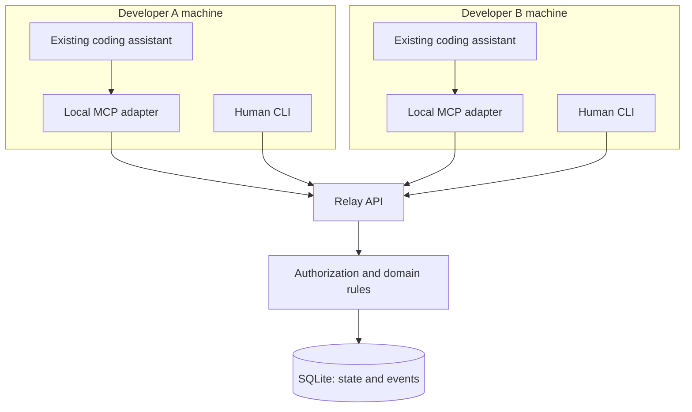

# Architecture

Status: proposed implementation design. Product boundaries are accepted; application components do not exist yet. See [the decisions](DECISIONS.md) for rationale.

## System shape

One relay service and database serve a two-person workspace. Each machine runs a local MCP adapter for its assistant and a human terminal interface. Both interfaces call the same relay and shared domain rules.



## Responsibilities

| Component | Responsibility | Boundary |
| --- | --- | --- |
| Domain layer | Validate identities, transitions, decision revisions, and retry keys | No HTTP, model calls, or shell execution |
| Relay API | Authenticate requests, validate payloads, invoke domain operations, return errors | No assistant launching or repository edits |
| SQLite store | Persist current state, messages, agreement revisions, and lifecycle events | One relay instance; local database, not a shared network filesystem |
| MCP adapter | Expose allowed inbox, request, reply, agreement, and completion actions | Agent credential cannot accept work or obtain human credentials |
| Human CLI | Inspect and accept or decline incoming requests | Distinct human credential, kept out of the assistant's configuration |

Planned language: TypeScript. Runtime: Node.js 24.x. Choose and document concrete libraries at implementation time. SQLite driver compatibility must be verified on the two participants' operating systems.

## Request lifecycle

```text
pending --addressed human accepts--> accepted --assigned agent starts--> in_progress
   |                                    |                                  |
   +--addressed human declines--> declined                                  +--> completed
   |
   +--requesting human cancels--> cancelled

accepted or in_progress --either participating human cancels--> cancelled
```

Terminal states are completed, declined, and cancelled. Further work uses a new request referencing the old one. Messages are allowed on a request without implicitly changing its lifecycle state.

Decisions are a separate revisioned record. Each participant's human or scoped agent may acknowledge an exact decision revision; this never substitutes for human task acceptance. Starting work requires all decision references attached to the request to have both participants' agreement on their current revision. A new revision clears current agreement and blocks further progress/completion transitions until re-agreed. It cannot automatically stop code already running locally; the agent learns of the change on its next inbox check.

Completion requires an assigned participant, a summary, repository-relative references, a branch, a full commit ID, and reported checks (including an explicit not-run outcome). A completion is self-reported. The relay does not fetch Git objects or independently run the tests in the first version.

## Minimal records

- Workspace: ID, canonical repository identity, creation time.
- Participant: ID, workspace ID, display name, declared ownership paths.
- Credential: hashed token, participant, workspace, human or agent role, revocation state.
- Request: ID, requester, recipient, description, state, selected refs, decision refs, version, retry key.
- Message: ID, request, author and role, bounded body, monotonically increasing event cursor, server time.
- Decision revision: decision ID, revision, selected interface text/refs, content hash, acknowledgments.
- Completion report: request, reporter, branch, commit, summary, check claims and references.
- Event: actor, request/decision ID, operation, before/after version, cursor, server time.

Use database transactions for each state change and event append. Do not implement full event sourcing: current state is stored directly and events provide an audit history. Retry keys are scoped to actor and operation; reusing a key with a different payload is an error. Version checks reject conflicting updates.

## Delivery and reconnects

The adapter explicitly requests events after its last cursor and deduplicates by event ID. Reading a message does not accept a task. Offline messages remain stored. No WebSocket or assistant-specific hook is required for the initial proof of concept. Add push delivery only after measuring the limitations of explicit checks.

## Trust and credentials

The relay operator and database are trusted with deliberately shared messages; end-to-end encryption is outside this first design. TLS is required for access beyond loopback. Never expose an unauthenticated development server to the internet.

Separate human and agent credentials are a server-side capability boundary, not protection from a fully compromised laptop. The human credential must not be passed to the MCP adapter, tool arguments, prompts, or logs. Provisioning, rotation, and local storage details need a dedicated implementation ADR before network testing.

Peer messages may contain misleading instructions. Display sender identity, role, and references; treat the content as untrusted input. The relay must never interpret message text as an executable command. Declared ownership is coordination metadata, not a filesystem sandbox.

## Proposed source layout

These directories are a plan, not implemented packages:

```text
src/domain/       Shared state machine and authorization rules
src/relay/        HTTP entry point and SQLite persistence
src/mcp/          Local assistant-facing adapter
src/cli/          Human control interface
tests/            Domain and integration scenarios
examples/         Synthetic two-person fixture
```

Keep one package until separate publishing or deployment needs justify splitting it. Deployment and real assistant compatibility remain unverified.
